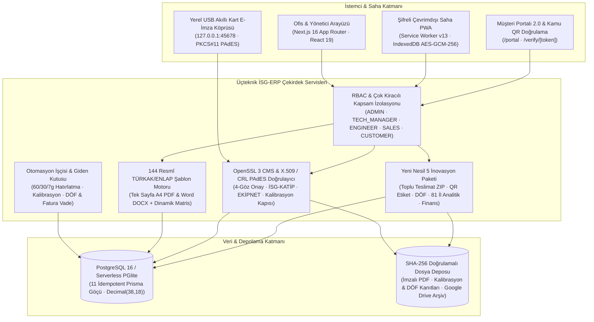

# Üçteknik İSG-ERP — 81 İl Periyodik Muayene, Raporlama, 5070 PAdES E-İmza ve Kurumsal Operasyon Sistemi

[](https://github.com/Atakanns-githu/ucteknik-isg-erp/actions)
[](https://nextjs.org/)
[](https://react.dev/)
[](https://www.prisma.io/)
[](./src)
[](./e2e)

**Üçteknik İSG-ERP**, 6331 sayılı İş Sağlığı ve Güvenliği Kanunu, *İş Ekipmanlarının Kullanımında Sağlık ve Güvenlik Şartları Yönetmeliği* ve 5070 sayılı Elektronik İmza Kanunu kapsamında Türkiye'nin 81 ilinde yürütülen periyodik kontrol, teklif, İSG-KATİP sözleşme, saha planlama, tek sayfa A4 resmî rapor üretimi, USB token PAdES e-imza, DÖF (Düzeltici/Önleyici Faaliyet), ekipman dijital karnesi, finans/tahsilat ve müşteri portalı süreçlerini uçtan uca yöneten kurumsal bir İSG-ERP platformudur.

- **Canlı Uygulama (Vercel Production):** [https://ucteknik-isg-erp-zynox6.vercel.app](https://ucteknik-isg-erp-zynox6.vercel.app)
- **GitHub Deposu:** [https://github.com/Atakanns-githu/ucteknik-isg-erp](https://github.com/Atakanns-githu/ucteknik-isg-erp)

---

## Sistem Mimarisi



---

## Öne Çıkan Kurumsal Yetenekler

### 1. 144 Resmî Rapor Şablonu & Tek Sayfa A4 PDF / Word (DOCX) Üretimi
- **6 Ana Kategori, 144 Resmî Şablon:** Kaldırma ve İletme Ekipmanları (`34`), Basınçlı Kaplar (`23`), İş Makineleri (`24`), Elektrik & Topraklama & Paratoner (`11`), İSG Ortam Ölçümleri (`11`), Tezgâhlar ve Tesisatlar (`41`).
- **Sıfır Taşmalı Tek Sayfa A4:** `pdf-lib` ve `docx` motorlarıyla tüm raporlar resmî antet, dinamik ölçüm matrisleri, otomatik hidrostatik/halat/topraklama formülleri, cihaz kalibrasyon tablosu, kusur fotoğrafları, denetçi/onaylayan imza blokları ve sağ-alt QR doğrulama kutusuyla **tek bir A4 sayfasına** otomatik ölçeklenir.

### 2. 4-Göz Teknik Onay, İSG-KATİP / EKİPNET Kapıları ve 5070 PAdES E-İmza
- **Zorunlu Kapılar:** Raporu yazan mühendis kendi raporunu onaylayamaz (`authorId !== reviewerId`). İş emrinde İSG-KATİP onayı (`APPROVED` veya gerekçeli `EXEMPT`), mühendisin EKİPNET/kategori yetkinliği ve ölçüm cihazlarının geçerli kalibrasyonu zorunludur.
- **Kriptografik PAdES Doğrulaması:** `FROZEN` aşamasında filigransız PDF üretilip SHA-256 özeti kilitlenir. USB token ile imzalanan PDF üzerinde OpenSSL 3 CMS imza doğrulaması, imzalı byte-range kapsamı, X.509 CA zinciri, `nonRepudiation`/`digitalSignature` KeyUsage ve CRL iptal kontrolleri yapılır.

### 3. Yeni Nesil 5 İnovasyon Paketi (Next-Gen İSG-ERP)
1. **Paket 1 — Fabrika Teslimat & Toplu İmza Hızlandırıcı (`/reports/sign-queue`, `/work-orders/[id]`):**
   - Tek tıkla iş emrindeki tüm imzalı PDF'leri + `00_Rapor_Fihristi.xlsx` özetini içeren **Toplu Teslimat Paketi (`.zip`)** (`/api/exports/delivery-pack`).
   - A4 `2×4` (sayfa başı 8 adet) suya/yağa dayanıklı **Vektörel QR Ekipman Etiketi PDF** (`/api/exports/qr-labels`).
   - **Geçen Yılın Raporlarını Klonla** (sabit fabrika/ekipman verilerini koruyup eski ölçüm ve fotoğrafları sıfırlayarak) ve 40 ayrı e-posta yerine **Tekli İş Emri Özet Bildirimi**.
2. **Paket 2 — Saha Ekipman Sicili, Toplu Excel/CSV İçe Aktarım, QR Okuyucu & Dijital Karne (`/assets`, `/assets/[id]`, `/field`):**
   - 2.000 satıra kadar `.xlsx`/`.csv` ekipman listesini Türkçe/İngilizce başlıklarla önizleyip aktaran sihirbaz (`/api/imports/assets/{template,parse}`).
   - `jsqr` + `BarcodeDetector` tabanlı kamera/fotoğraf/manuel **Saha QR Okuyucu** ve ekipman bazlı **Dijital Karne** zaman çizelgesi.
3. **Paket 3 — DÖF / Uygunsuzluk Takip Motoru & Müşteri Portalı 2.0 (`/nonconformities`, `/portal`):**
   - `KUSURLU_UYGUNDUR` (`MAJOR`, +30 gün) ve `UYGUN_DEGILDIR` (`CRITICAL`, +15 gün) raporlar yayımlandığında otomatik `Nonconformity` (DÖF) kaydı açılır.
   - Müşteri portalından giderim kanıtı (fotoğraf + açıklama) yüklendiğinde durum `EVIDENCE_SUBMITTED` ("Kanıt Yüklendi") olur; yetkili teknik personel incelemesi veya aynı ekipmanda yeni `UYGUNDUR` takip raporu yayımlanmasıyla `CLOSED` durumuna geçer.
4. **Paket 4 — Akıllı Saha Planlama Takvimi & 81-İl Yönetici Analitik Panosu (`/planning`, `/analytics`):**
   - Haftalık/Aylık/Liste mühendis takvimi, aynı gün farklı il (`crossCity`) çakışma uyarısı, EKİPNET/kalibrasyon hazırlık rozetleri ve 81 il / 7 bölge SVG ısı haritalı yönetici analitiği.
5. **Paket 5 — Operasyonel Fatura & Tahsilat Defteri & Dinamik Mesaj Şablonları (`/finance`, `/settings/templates`):**
   - Onaylı teklif veya tamamlanan iş emrinden `Decimal(38,18)` kuruş hassasiyetli fatura oluşturma, kısmi/tam tahsilat (`InvoicePayment`), vadesi geçmiş alacak takibi, `.xlsx` ihracatı ve `{{musteri}}`, `{{ekipman}}`, `{{rapor_no}}` değişkenli canlı mesaj şablon editörü.

---

## Hızlı Kurulum ve Çalıştırma

```bash
# Bağımlılıkları yükleyin ve Prisma istemcisini üretin
pnpm install

# Ortam değişkenlerini kopyalayın
cp .env.example .env.local

# PostgreSQL göçlerini uygulayın ve başlangıç verilerini yükleyin
pnpm prisma:deploy
pnpm prisma:seed

# Geliştirme sunucusunu başlatın (http://localhost:3000)
pnpm dev
```

---

## Kalite Kapıları ve Doğrulama Özeti

| Kontrol | Komut | Sonuç |
| :--- | :--- | :--- |
| TypeScript Tip Denetimi | `pnpm typecheck` | **`0` hata** |
| ESLint Statik Analiz | `pnpm lint` | **`0` hata** |
| Birim & Entegrasyon Testleri (Vitest) | `pnpm test` | **`49/49` dosya, `366/366` test başarılı** |
| Üretim Derlemesi & Standalone Denetimi | `pnpm build` | **`0` Turbopack uyarısı, `exit 0`** |
| Canlıya Geçiş Ön Kontrolü | `pnpm preflight:prod` | **`11 PASS \| 5 WARN \| 0 FAIL -> HAZIR`** |
| İzole Yedek & Geri Yükleme Tatbikatı | `pnpm drill:restore` | **`%100` satır ve göç eşleşmesi (`exit 0`)** |
| Playwright E2E (PGlite + Gerçek PostgreSQL 16) | `pnpm test:e2e` | **Toplam `45/45` benzersiz E2E senaryosu %100 başarılı** |
