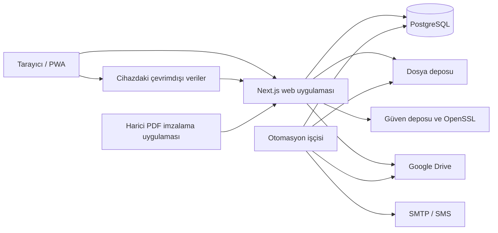

# Mimari

Bu belge kaynak kodun mevcut yapısını açıklar. Çalıştırma ve kabul adımları [üretim kılavuzunda](DEPLOYMENT.md), açık doğrulamalar [uygulama kaydında](IMPLEMENTATION.md) bulunur.

## Çalışma bileşenleri

- Next.js App Router sayfaları, sunucu işlemleri ve `src/app/api` altındaki HTTP rotaları arayüzü ve iş akışlarını sunar. Oturum ve rol kontrolleri `src/lib/guard.ts` ile `src/lib/rbac.ts` içindedir. Kayıt kapsamı filtreleri `src/lib/security/resource-scope.ts` içinde tanımlanır.
- Prisma istemcisi PostgreSQL'e bağlanır. Modeller, ilişkiler, indeksler ve varsayılanlar [Prisma şemasında](../prisma/schema.prisma), sürümlü şema değişiklikleri `prisma/migrations` altındadır. [Veri sözlüğü](DATA_DICTIONARY.md) model amaçlarını ve kritik alanları açıklar.
- `STORAGE_DIR` dosya deposunu seçer. Depo rapor PDF'leri, ekler, fotoğraflar ve diğer dosyaları tutar. Veritabanında dosya anahtarları ve ilgili bütünlük bilgileri saklanır. Web ve işçi aynı depoyu kullanır. [Depo uygulaması](../src/lib/storage.ts)
- Ayrı işçi otomasyon, ileti kuyruğu ve yapılandırılmış Drive arşiv aktarımını işler. Compose yapılandırmasında web ve işçi ayrı profillerdedir, PostgreSQL ile web portları varsayılan olarak yerel adrese bağlanır. [Compose](../docker-compose.yml)
- Çevrimdışı saha çalışma alanı cihazda taslak ve kanıt tutar. Çevrimiçi aktarım oturum hesabını ve gönderim kimliklerini denetler. [Saha veritabanı](../src/lib/offline/field-db.ts)
- Sağlık rotası veritabanı sorgusunu ve dosya deposunun erişilebilirliğini kontrol eder. Sonuç kısa süreli önbelleğe alınır. [Sağlık rotası](../src/app/api/health/route.ts)
